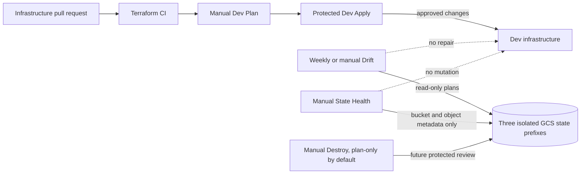

# HelpDesk Cloud infrastructure

This repository owns the Google Cloud infrastructure for the HelpDesk Cloud capstone. The companion [Application repository](https://github.com/mhachem110/HelpDeskCloud-App) owns .NET, container, Helm, Kubernetes application delivery and the HTTPS Gateway release.

## Deployed Dev infrastructure

The Dev environment is in project helpdeskcloud-capstone-511905 (project number 260283083469), region us-east1. Terraform manages the VPC and subnet, GKE Autopilot cluster, Artifact Registry, private Cloud SQL PostgreSQL, IAM identities and grants, Secret Manager metadata, and the HTTPS certificate foundation. The deployed application uses cluster helpdeskcloud-dev-gke, namespace helpdesk-dev and private Cloud SQL instance helpdeskcloud-dev-postgres.

The project-level Terraform service account intentionally retains roles/iap.admin at the owner's request after prior IAM access failures. Preserve this grant. End-user IAP access is a separate exact backend grant for one approved Google account in the https-access root. Stage and Prod variables and state prefixes are prepared, but those environments are not represented as deployed.

Known deployment evidence: [Dev Terraform Apply #45](https://github.com/mhachem110/HelpDeskCloud-Infra/actions/runs/39543113140), [Dev Terraform Plan #42](https://github.com/mhachem110/HelpDeskCloud-Infra/actions/runs/39540729992), and [Dev backend initialization #18](https://github.com/mhachem110/HelpDeskCloud-Infra/actions/runs/39536157570).

Read [Architecture](docs/ARCHITECTURE.md), [Deployment](docs/DEPLOYMENT.md), [Rebuild](docs/REBUILD.md), [Operations](docs/OPERATIONS.md), and [Code Walkthrough](docs/CODE-WALKTHROUGH.md). Historical phase and incident notes live in [docs/history](docs/history/README.md); their old status claims are historical.

## Terraform roots and state

Three roots have separate GCS state prefixes and ownership boundaries:

| Root | State prefix | Responsibility |
|---|---|---|
| terraform/ | helpdeskcloud/dev | VPC, Artifact Registry, Cloud SQL, GKE, Workload Identity, service accounts and Secret Manager metadata |
| terraform/https-foundation/ | helpdeskcloud/dev-https | Reserved HTTPS address, TLS policy, Certificate Manager map and certificates |
| terraform/https-access/ | helpdeskcloud/dev-https-access | The single approved-user IAP grant on the selected backend |

The existing bucket is helpdeskcloud-tfstate-511905. State names and resource addresses are established; do not rename roots, bucket or prefixes, edit state by hand, or use workspaces as substitutes. The VPC module provides the VPC, subnet, GKE Pod and Service ranges, and private services access range used by both GKE and Cloud SQL. PostgreSQL has no public IPv4. GKE Autopilot nodes are private and Pods use Workload Identity.

Terraform manages Secret Manager secret metadata and service-account access, while secret payloads are external inputs. OAuth client secrets and DNS-provider credentials are also external; they do not belong in Git or Terraform outputs.

## Six Terraform workflows

The daily engineering route is **Terraform CI → Terraform Dev Plan → protected Terraform Dev Apply**. Operations add three separate, manually controlled workflows:

| Workflow | Trigger | Effect |
|---|---|---|
| Terraform CI | Pull request | Offline configuration, policy and guard checks; no Google credentials |
| Terraform Dev Plan | Manual | Read-only plan and strict drift validation for one selected root |
| Terraform Dev Apply | Manual | Fresh guarded plan, protected `dev-network-apply` approval, then infrastructure changes |
| Terraform Drift Detection | Weekly and manual | Read-only plans and sanitized action summaries; never repairs drift |
| Terraform State Health | Manual | Checks bucket settings, exact state object metadata and version history; never downloads state |
| Terraform Dev Destroy | Manual, default `plan-only` | Future teardown review with stronger safeguards; **implemented for future use — disabled for live destructive execution** |

OIDC provides short-lived cloud credentials without service-account keys. Existing WIF provider trust includes exact workflow identities for the retained workflows; this repository-only change did not inspect or modify the live provider configuration. Before running the new workflows, verify the existing provider permits the new workflow refs and that the existing identity has the required read access. GitHub branch and Environment protection remain in force. No Stage or Prod apply workflow is enabled.

## Local validation

Install Terraform 1.16.2, TFLint and Checkov. From the repository root:

    terraform -chdir=terraform fmt -check -recursive
    terraform -chdir=terraform init -backend=false -input=false -lockfile=readonly
    terraform -chdir=terraform validate -no-color
    terraform -chdir=terraform/https-foundation init -backend=false -input=false -lockfile=readonly
    terraform -chdir=terraform/https-foundation validate -no-color
    terraform -chdir=terraform/https-access init -backend=false -input=false -lockfile=readonly
    terraform -chdir=terraform/https-access validate -no-color
    python -m unittest discover -s scripts -p 'test_*.py' -v

CI also runs TFLint on each root and Checkov on Terraform. Backend-free init and validate do not contact GCS. A real read-only Plan needs the existing authorized identity and state access; use the manual workflow and selected root. Do not run apply, destroy, state migration or resource-changing commands as repository cleanup.

## Repository map

- .github/workflows/terraform-ci.yml — credential-free PR checks across all roots.
- .github/workflows/terraform-dev-plan.yml — manual read-only plan and safety validation.
- .github/workflows/terraform-dev-apply.yml — separate protected Dev Apply and verification.
- .github/workflows/terraform-drift.yml — scheduled/manual read-only drift plans.
- .github/workflows/terraform-state-health.yml — manual, metadata-only state recovery audit.
- .github/workflows/terraform-dev-destroy.yml — future-only, strongly gated teardown review.
- scripts/dev_infra_guard.py — strict core plan, drift, IAM and post-apply evidence checks.
- scripts/dev_destroy_guard.py — exact target, backup, environment and inventory checks for future teardown.
- scripts/terraform_state_health.py — bucket, prefix, lifecycle and version-history policy checks.
- scripts/dev_https_guard.py — HTTPS foundation/access plan safety checks.
- scripts/prepare_dev_https_target.sh — read-only backend discovery for the isolated HTTPS Plan.
- terraform/ — core network, data, cluster and identity root.
- terraform/https-foundation/ — certificate, address, map and TLS policy root.
- terraform/https-access/ — narrowly scoped IAP access root.
- terraform/modules/network/ — reusable VPC and private services networking.
- docs/history/ — retained implementation history and incident records.
