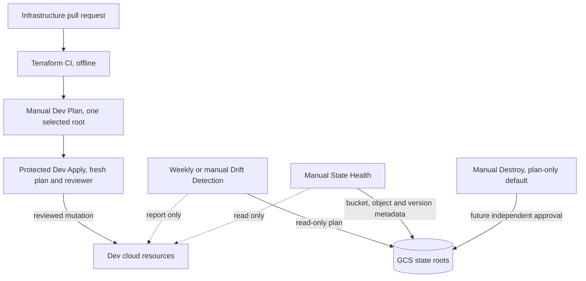

# Infrastructure architecture

## Deployed Dev request path

    User
      → helpdeskcloud.dynv6.net DNS
      → Google global HTTPS load balancer at 34.8.56.208
      → Certificate Manager certificate map and TLS 1.2+ policy
      → Google Identity-Aware Proxy
      → GKE Gateway in helpdesk-dev
      → internal helpdesk-helpdesk ClusterIP Service
      → two ASP.NET Core pods and Cloud SQL Auth Proxy sidecars
      → private Cloud SQL PostgreSQL 17

Terraform owns the shared cloud foundation and the three isolated state roots. The App repository owns Kubernetes application and Gateway release manifests. Google IAP is attached to the GKE backend; the app also validates Google's signed identity assertion. The active host is helpdeskcloud.dynv6.net. Its IAP backend service ID is 4800183520372038985.

## Core Terraform root

The terraform/ root manages the Dev VPC, subnet, secondary Pod and Service ranges, private services access, Artifact Registry, Cloud SQL, GKE Autopilot, node and Pod service accounts, Workload Identity grants, and Secret Manager metadata/access. The network module creates one reusable boundary consumed by both GKE and Cloud SQL. Cloud SQL has no public IPv4; private services access connects the service to the VPC. GKE uses private nodes and Workload Identity rather than static service-account keys for Pods.

Secret values, OAuth client credentials and DNS-provider credentials are external inputs. Terraform manages required secret metadata and IAM without storing or printing secret payloads.

## HTTPS foundation and access roots

terraform/https-foundation/ owns the reserved static address, TLS policy, Certificate Manager map, managed certificates and hostname entries. terraform/https-access/ owns the exact user-level IAP role binding on the chosen GKE backend. The active approved user is mahmoud.hachem23743@gmail.com with roles/iap.httpsResourceAccessor on that backend.

The Terraform service account keeps project-level roles/iap.admin at the owner's explicit request. This administrative grant is separate from the narrow application-user grant and must remain.

## Six workflow entry points

Terraform CI has no Google credentials and validates repository changes. Dev Plan authenticates through OIDC, reads one selected state root and validates the plan. Dev Apply repeats a fresh plan, requires the protected `dev-network-apply` Environment and then may change resources. Drift Detection uses normal read-only plans and reports action/address summaries without repair. State Health is manual and checks bucket configuration, exact object metadata and version history without reading state contents. Neither operational audit has been run against live GCP as part of this repository assignment.

Terraform Dev Destroy is a manual future-use workflow with `plan-only` as its default. Any future execution requires the exact Dev project/ref/root, a separate fingerprint review, an independent required reviewer with self-review blocked, dev-only Environment rules, a disabled-by-default opt-in, typed confirmation and verified restore-tested backups. It is **implemented for future use — disabled for live destructive execution**. It does not create the Environment or enable the opt-in. The current Cloud SQL and certificate lifecycle protections also block their destruction through this workflow.

The state bucket is helpdeskcloud-tfstate-511905 with independent prefixes helpdeskcloud/dev, helpdeskcloud/dev-https and helpdeskcloud/dev-https-access. Separate roots keep unrelated resource ownership and plans isolated. Stage and Prod prefixes are prepared but are not deployments. Never rename the bucket or prefixes or move resources between roots without a separate state migration plan.
