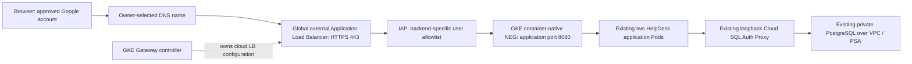

# Dev HTTPS access preparation

Status: design and offline preparation only, 2026-10-20. No Apply, cluster change,
DNS change, public frontend, certificate, OAuth client or access grant is authorized
by this document. Review this with the App repository's `docs/HTTPS-ACCESS.md`.

## Verified baseline

Sources were the current `dev` definitions, read-only Cloud Shell commands against
project `helpdeskcloud-capstone-511905`, and successful [App delivery
39466841649](https://github.com/mhachem110/HelpDeskCloud-App/actions/runs/39466841649).
That run's build/scan, protected publication, protected deployment and health
checks all succeeded. [Infra verification
39465454537](https://github.com/mhachem110/HelpDeskCloud-Infra/actions/runs/39465454537)
also succeeded with no Terraform changes required.

| Area | Repository definition | Live evidence in this assessment |
| --- | --- | --- |
| VPC | `terraform/main.tf`, `modules/network/main.tf`: custom `helpdeskcloud-dev-vpc`, regional routing | Custom mode and REGIONAL confirmed |
| Subnet | `helpdeskcloud-dev-subnet`, `us-east1`, nodes `10.20.0.0/20`, Pods `10.24.0.0/16`, Services `10.25.0.0/20` | All three ranges and Private Google Access confirmed |
| GKE | `terraform/gke.tf`: Autopilot, VPC_NATIVE, private nodes, DNS control plane, IP endpoints disabled | Cluster `1.36.4-gke.1495002`, ADVANCED_DATAPATH, private nodes and disabled IP endpoints confirmed |
| Gateway support | No explicit Gateway API block in Terraform | STANDARD channel; `gke-l7-global-external-managed` GatewayClass Accepted=True, already available |
| Application | App Helm delivery overlay creates Deployment + ClusterIP Service only | `helpdesk-helpdesk`: 2/2 ready and available; Service `10.25.12.38`, port 80, no external IP |
| Routing/security policies | No repository Gateway/Ingress/HTTPRoute definitions | No Gateway, HTTPRoute, Ingress, GCPBackendPolicy, HealthCheckPolicy or NetworkPolicy returned across namespaces |
| Firewall | No custom public application firewall resource in Terraform | Two GKE-managed rules, sourced from Pod range `10.24.0.0/16` and node range `10.20.0.0/20`; no public app rule returned |
| Routing / SQL | Existing PSA allocation and private PostgreSQL 17 | Default internet-gateway route, local subnet/secondary routes and `10.30.0.0/24` service peering route; no Cloud Router returned. SQL RUNNABLE, public IPv4 disabled, only private `10.30.0.3` in the Dev VPC |
| Load balancing | No Terraform-owned public LB | No forwarding rules, external address reservations, backend services, URL maps, Compute SSL certificates or Cloud Armor policies returned |
| DNS | No Terraform public zone or records | One GKE-managed **private** `cluster.local.` zone; no public zone returned |
| APIs | APIs are existing prerequisites, not managed by this root | Compute, Container and DNS enabled; IAP and Certificate Manager absent from enabled API list |
| Organization/OAuth | No consent screen or custom OAuth client managed here | Project response has no organization parent; OAuth consent/client settings were not inspected or created |
| Credentials | Terraform owns Secret Manager metadata/IAM; owner supplies secret versions | No secret payload was read in this assessment |

The cluster API response includes a legacy `publicEndpoint` field, but its
`controlPlaneEndpointsConfig.ipEndpointsConfig.enabled` is false. Do not treat the
legacy field as an enabled public management endpoint or change the existing
DNS-based CI connection method.

The current browser access requires port-forwarding because there is no HTTP(S)
frontend or external route to the ClusterIP. Private database connectivity is
already working; it needs no change for website HTTPS.

### Identity and Terraform boundaries

| Identity / policy | Definition and existing scope |
| --- | --- |
| `helpdesk-gke-node-dev` | `gke-iam.tf`: GKE runtime role on project and Reader on the Dev Artifact Registry repository |
| `helpdesk-app-dev` / KSA `helpdesk-dev-app` | `gke-iam.tf`, `secret-manager.tf`: Cloud SQL Client, exact KSA impersonation, Secret Accessor on `helpdesk-dev-db-connection` for both the GSA and direct workload principal |
| `helpdesk-migrate-dev` / migration KSA | Separate Cloud SQL Client and access to only the migration admin-password secret; existing completed migration is not involved in HTTPS |
| `helpdesk-app-publisher-dev` | `github-app-delivery-wif.tf`: Writer on Dev image repository; provider `github-app-publish-dev` |
| `helpdesk-app-deployer-dev` | Same file: project Cluster Viewer for DNS-endpoint discovery/connect; provider `github-app-deploy-dev`; App `k8s/dev-delivery-rbac.yaml` grants namespace delivery rights |
| Support image publisher and migration runner | Separate providers/service accounts in their own Terraform files; no web-user identity or HTTPS purpose |
| Terraform Dev runner | Existing external bootstrap identity `helpdesk-terraform-dev`, provider `github-infra-dev`, existing locked GCS backend `helpdeskcloud-tfstate-511905` / `helpdeskcloud/dev` |

The App providers require repository `mhachem110/HelpDeskCloud-App`, its numeric
repository/owner IDs, `refs/heads/dev`, exact `app-dev-delivery.yml` workflow ref
and respective protected Environment. The successful delivery verified the two
Environments' required reviewers and dev-only branch policies before OIDC.
GitHub promotion/protection remains the trust boundary for reviewed source.
The App workflow uses `use_dns_based_endpoint: true`; no control-plane networking
change is needed for HTTPS serving.

These IAM scopes are repository definitions and were exercised by the successful
delivery / Infra verification cited above. A later attempt to freshly read the
runtime secret IAM and namespace Role failed when Cloud Shell reported no active
account. Those policies were **not freshly verified** in that attempt; repeat
their metadata-only reads with a valid session before a future deployment.
OAuth client configuration and IAP effective/inherited IAM also remain unverified.

`dev_infra_guard.py` checks the full planned resource-address set, type, selected
identity/security values, prior state, actions and drift. It accepts only its
reviewed create/recovery/no-op cases and narrow provider normalizations. A
separate drift fingerprint acknowledgement does not authorize arbitrary resource
changes. HTTPS resources must get an explicit reviewed phase/guard before a
future Apply; this preparation adds no exception or new allowed type.

## Recommended architecture and alternatives

Use GatewayClass `gke-l7-global-external-managed`, a retained global static IPv4,
one owner-selected hostname, and a Certificate Manager Google-managed certificate
with DNS authorization. Keep the existing Service as ClusterIP. GKE's controller
creates the load balancer and zonal Pod NEGs from Gateway/HTTPRoute objects;
Terraform must not import or also manage those generated objects.

Plan a global MODERN SSL policy with minimum TLS 1.2, referenced by
GCPGatewayPolicy. The HTTPS listener is port 443 only; omit an HTTP listener
initially. TLS terminates at the load balancer; private backend HTTP on 8080
remains explicit, so this proposal does not claim application-level TLS all the
way into the Pod. [Gateway SSL policy attachment](https://docs.cloud.google.com/kubernetes-engine/docs/how-to/configure-gateway-resources#configure_ssl_policies_to_secure_client-to-load-balancer_traffic).

| Option | Assessment |
| --- | --- |
| GKE Gateway + global external Application LB + IAP | Recommended; managed controller, existing accepted class, no extra proxy workload or regional proxy subnet |
| GKE Ingress + managed TLS + IAP BackendConfig | Supported fallback, but a second configuration model gives this app no clear benefit; do not mix Ingress and Gateway for this backend |
| Terraform-managed LB with standalone NEGs | More ownership and synchronization work as Pods/cluster change; avoid for this capstone |
| Regional external Gateway | Adds proxy-only subnet and different certificate configuration; unnecessary here |
| Cloud Run provider URL, self-managed proxy or tunnel | Changes the serving architecture or introduces another access service; not part of this extension |

GKE Gateway requires VPC-native networking and the HTTP load-balancing add-on.
Autopilot already supplies Gateway API support. The GatewayClass check passed;
the cluster describe response did not explicitly return the HTTP add-on field,
so confirm it is enabled before rollout. Global Gateway avoids the proxy-only
subnet needed by regional variants. [GKE prerequisites and ownership](https://docs.cloud.google.com/kubernetes-engine/docs/how-to/deploying-gateways).

## Authentication boundary

Use IAP with **one configurable personal Google account**. Future configuration
must require `iap_allowed_email`, with no default and no inferred email. Validate
that it is a single account address; construct `user:${iap_allowed_email}`.
Bind only `roles/iap.httpsResourceAccessor` on this application's exact IAP backend
service. Reject `allUsers`, `allAuthenticatedUsers`, domains, groups, wildcard
members and project-wide IAP grants for the initial personal-account design.

The documented Gateway configuration uses `GCPBackendPolicy.spec.default.iap`
with `enabled: true`, a custom OAuth client ID, and an existing same-namespace
Kubernetes Secret reference for the client secret. Do not use an Ingress
BackendConfig for Gateway. [Gateway IAP configuration](https://docs.cloud.google.com/kubernetes-engine/docs/how-to/configure-gateway-resources).

A personal account/project without an organization requires a custom OAuth
configuration; Google-managed OAuth clients are limited to organization users.
The owner must configure the external audience, consent/branding and web OAuth
client through the supported Google Auth Platform flow, including the IAP
redirect URI. A consent-screen test-user list is separate from the IAP IAM
allowlist. Do not automate the retired IAP OAuth Admin API or put the secret in
Terraform variables/state, Helm values, Git, workflow inputs, outputs or logs.
Store it through an approved secret-delivery mechanism. [Custom OAuth requirements](https://docs.cloud.google.com/iap/docs/custom-oauth-configuration).

IAP must cover the single backend used for **all** website and `/api/*` paths.
There must be no second unprotected backend, wildcard route or public Service.
Application code currently has no authentication middleware or ticket ownership
checks. Every admitted user can read, create, update and delete all tickets. IAP
does not implement per-ticket roles or ownership; initial use is restricted to
the owner with demonstration data.

Before ticket routes are exposed, add opt-in signed IAP assertion validation to
the .NET app using a maintained JWT library. Validate signature/ES256, issuer,
expiry/issued-at and the exact generated backend-service audience; reject missing
or forged assertions on website/API paths. Keep only the exact liveness/readiness
probe paths exempt. This is validation of Google's login boundary, not a new
custom login system. Google requires signed-header validation to protect against
IAP bypass, including internal direct access. Do not trust unsigned email headers.
[Signed assertion requirements](https://docs.cloud.google.com/iap/docs/signed-headers-howto).

Add a reviewed ingress NetworkPolicy for the existing app Pods, allowing only
the LB/health-check sources on 8080, and verify kubelet probes and existing SQL
connectivity. Validate GFE source ranges against the chosen class at rollout.
Keep 5432 and proxy health ports out of all Services/routes. Do not add default
deny egress or a NAT gateway as a side effect. Verify that signing-key retrieval
and rotation work from private Pods; Private Google Access supports additional
Google domains, but that specific live request is not yet tested.
[Private Google Access configuration](https://docs.cloud.google.com/vpc/docs/configure-private-google-access).

The existing App deployer can manage Deployments and namespace Secrets for Helm
release storage. It is a trusted deployment identity and can read/mount a future
same-namespace OAuth Secret. Do not claim namespace RBAC isolates that secret
from the deployer. Protected source/review gates remain necessary; changing Helm
storage alone would not prevent a Deployment editor from mounting a Secret.

Cloud Armor is optional for this single-user capstone. Consider rate limits and
WAF rules after measuring need, with explicit cost approval. It does not replace
IAP, signed assertions or application authorization. Leave Cloud CDN disabled
for ticket data.

## Domain and certificate inputs

No domain is selected. No domain or email is invented in this preparation.
The selected GKE load balancer does not supply a ready-to-use public HTTPS
hostname/certificate like Cloud Run. A stable IP alone is insufficient for this
domain certificate design. Third-party wildcard IP hostnames would introduce an
unowned DNS dependency and are not recommended for permanent access.

The owner must choose a controlled hostname or obtain a delegated subdomain.
Cloud DNS is optional: the existing DNS provider can publish the certificate's
DNS-authorization CNAME and later the hostname's A record to the retained IP.
Do not create an AAAA record without an IPv6 frontend. Check existing CAA and
proxying settings. DNS authorization allows certificate issuance before exposing
ticket traffic; retain its CNAME for renewals. Wait for certificate ACTIVE and
DNS propagation rather than promising immediate readiness.
[DNS-authorized certificate setup](https://docs.cloud.google.com/certificate-manager/docs/deploy-google-managed-dns-auth).

Future required inputs: `https_hostname`, `iap_allowed_email`, OAuth client ID,
approved OAuth-secret reference/version, static-IP reservation name, certificate
map name, and discovered backend-service name/ID. All begin unset; enabling
access with missing inputs must fail. DNS-provider access and domain purchase
remain separate owner approvals.

## Ownership and future changes

No `.tf` resource is added in this PR. The current exact-address plan guard
continues to reject unapproved edge resources. Extending it before the final
domain, account and lifecycle decisions would grant an undefined change scope.

| Owner | Future resources / configuration | Rebuild handling |
| --- | --- | --- |
| Existing Terraform Dev root | Existing VPC, subnet, PSA, SQL, GKE, runtime identities and workload grants | Existing protections retained; no replacements for HTTPS |
| Proposed retained edge foundation Terraform root, same GCS bucket with a distinct reviewed prefix | `google_compute_global_address` EXTERNAL/PREMIUM, `google_compute_ssl_policy` minimum TLS 1.2/MODERN, Certificate Manager DNS authorization, certificate, map and entry; OAuth secret **metadata** only if needed | Retain across disposable cluster teardown; use `prevent_destroy` and reviewed teardown policy |
| Explicit API bootstrap ownership | IAP and Certificate Manager enablement; existing Compute/Container/DNS retained | Do not disable APIs on Dev teardown; do not claim they are Terraform-managed today |
| DNS owner | Authorization CNAME and public A record; optional future `google_dns_record_set` only with approved zone | Preserve when retaining edge foundation; update A if owner chooses to release the IP |
| Namespace platform bootstrap, separately reviewed stage behind existing deployment approval | Gateway, GCPGatewayPolicy, GCPBackendPolicy, HealthCheckPolicy, HTTPRoute, OAuth Secret delivery, NetworkPolicy | Recreate declaratively; controller recreates LB and NEGs; never Helm app-release ownership |
| Backend-specific access Terraform phase after discovery | `google_iap_web_backend_service_iam_member`, one configurable user, exact global backend | Backend ID/name may change on cluster rebuild; rediscover/rebind; no guessed names or project-wide fallback |
| Existing App Helm release | Existing Deployment and ClusterIP Service; future opt-in signed-assertion config | Two replicas/probes and DB path retained; app deployer needs no new edge permissions in this preparation |

The retained edge root is a proposal, not a state migration in this change. Reuse
the existing GCS bucket with separate locking/prefix; never initialize another
root against `helpdeskcloud/dev`. Its future guard must validate exact addresses,
project, EXTERNAL/PREMIUM scope, hostname, cert references and metadata-only
secret handling, and reject unexpected updates, deletes, replacements and IAM.
Adding an acknowledgement must not bypass those checks. Test create/no-op,
unrelated change, broad user grants and teardown attempts. The current Dev root
needs no new allowed resource types when edge foundation is separate.
Extend the CI root matrix to validate/scan the new root with the same pinned
Terraform/provider versions. Existing protected Plan/Apply must select only
enumerated reviewed roots, with an exact backend prefix and guard per root;
never accept arbitrary working-directory or state-prefix workflow inputs.

Backend IAM is deliberately a second phase: the backend exists only after GKE
reconciles routing. Pass its discovered exact name/ID to the access phase after
validating the Gateway/Service association. Keep the IAP member out of the
retained certificate/IP root so backend replacement cannot block foundation
planning. No Terraform dependency may require a not-yet-created backend to
create its own Gateway or application.

## Protected delivery sequence for a later authorization

1. Review/merge prerequisite PRs only after CI. This request authorizes no merge.
2. Supply domain and single account, configure OAuth safely, review API/IAM/quota
   prerequisites and LB budget. Check existing resources before creating any.
3. Run reviewed edge Terraform Plan, approve `dev-network-apply`, and Apply only
   the checked plan. Preserve existing remote state and deletion protection.
4. Publish DNS authorization with approval; wait for the retained certificate.
5. Through a separately reviewed protected bootstrap stage, create the Gateway,
   backend/health policies and an **Exact `/health/live`-only** route. No root or
   ticket route yet. Health checks use app port 8080 and `/health/ready`.
6. Discover backend identity; verify policy Accepted status and live IAP enabled;
   apply only the backend-specific user grant. An unauthenticated health-route
   request must now encounter IAP. Review inherited IAP grants as well.
7. Deliver the signed-assertion application change/config through the existing
   `app-dev-delivery.yml` flow: scanned immutable image, `dev-app-publish`, then
   `dev-app-deploy`. Configure the exact backend audience and verify missing,
   forged, expired and wrong-audience assertions are rejected; probes remain
   healthy. Ensure public signing-key refresh works from the private network.
8. After those checks and explicit approval, expand only the approved hostname
   route to `/`, then publish the A record. Recheck Gateway/route conditions,
   NEG/backend health, certificate and restricted access before claiming success.

The health-only stage avoids a reconciliation interval in which ticket paths
could reach a backend before IAP becomes effective. Later control changes must
also preserve signed-assertion enforcement. This sequence still needs deployment
implementation and live tests; no routing manifest is applied or enabled here.

Existing workflow names, OIDC providers/conditions, immutable digests, Trivy,
Checkov, promotion routes and separate protected publication/deployment gates
remain intact. A future bootstrap stage must use existing protected approvals
and a reviewed namespace Role for only the named edge kinds; it must not gain
cluster-admin or change CRDs/GatewayClasses. IAP IAM needs separately reviewed
resource-policy permissions; do not add Owner/Editor or blanket IAM roles.

## Destroy-and-rebuild implications

The current Dev guard expects the Phase 5-6 base in prior state and rejects
destruction; a full empty-state rebuild is **not currently implemented**.
Cloud SQL/GKE/Secret Manager deletion protection and database `prevent_destroy`
must not be removed by an HTTPS PR. A future destructive exercise needs its own
review, backup/restore plan and explicit authorization.

Before cluster deletion in that future exercise, remove edge Kubernetes objects
through their owning stage and wait for controller cleanup of LB, NEGs, health
checks and firewall rules. Abrupt cluster deletion can leave orphaned billable
cloud resources; inventory and reconcile them instead of assuming cleanup.
The app Service and two-replica Deployment are recreated by their existing owner.

Retain IP/certificate/DNS authorization, OAuth client and secret version, owner
allowlist configuration, project/billing/APIs, GCS state bucket and locks,
Terraform runner GSA and Infra WIF bootstrap, GitHub branch protections and
Environments. These are outside the disposable cluster boundary. Existing App
WIF/runtime identities are Terraform-managed and must be recreated before App
delivery if the Dev stack is later removed. Preserve Artifact Registry images
and database/credential recovery evidence as that exercise requires.

Recreate cluster/bootstrap/app first, route only health, rediscover the generated
backend, rebind IAP user and update the app's JWT audience, verify auth, then
restore ticket routes. Retained DNS can point to the same static IP while the LB
is absent; requests will fail during the exercise. Releasing the IP or removing
the domain means a permanently stable URL cannot be guaranteed without updating
DNS and possibly provisioning a new certificate.

## Additional costs and acceptance

Indicative USD list prices checked 2026-10-20, using 730 hours/month:

| Item | Expected increment |
| --- | --- |
| Global LB forwarding-rule tier | $0.025/hour, about $18.25/month for the initial tier, plus processed traffic, internet transfer and any logging; not a total-project estimate. [LB pricing](https://cloud.google.com/load-balancing/pricing) |
| Retained global IPv4 | No separate address charge while attached to a forwarding rule; an unused reservation can cost $0.01/hour, about $7.30/month during teardown. [IP pricing](https://cloud.google.com/vpc/pricing) |
| Certificate Manager | First 100 certificates per project in the listed tier are free; key-type/connection exceptions apply. [Certificate pricing](https://cloud.google.com/certificate-manager/pricing) |
| Basic IAP | Core GCP access protection has no additional IAP charge; premium features are excluded. [IAP pricing](https://cloud.google.com/iap/pricing) |
| Optional Cloud DNS | First zone tier about $0.20/zone/month plus queries; external provider can remain. [DNS pricing](https://cloud.google.com/dns/pricing) |
| Optional Cloud Armor Standard | About $5/policy/month + $1/rule/month and $0.75/million globally scoped requests; no Enterprise enrollment proposed. [Armor pricing](https://cloud.google.com/armor/pricing) |
| Other | Domain registration, OAuth secret storage/access and extra logging may add charges; no extra app replicas, NAT or database changes proposed |

Before deployment is called successful, verify ACTIVE certificate and expected
DNS/IP, accepted/programmed Gateway/Route/policies, healthy NEGs, exact IAP user
grant, rejected anonymous/unapproved access to UI and ticket endpoints, signed
assertion bypass tests, successful approved-account ticket persistence, two ready
replicas, unchanged private SQL, and no alternate exposure path. Do not use the
public URL, LB or authentication as demonstrated functionality before these tests.

This preparation implements only reviewable documentation and an App manifest
ownership/exposure check. It deploys none of the proposed HTTPS architecture.

### Preparation validation

- Terraform 1.16.2: recursive formatting, backend-disabled/lockfile-readonly init
  and validation passed with Google provider 7.8.0. Local PATH had Terraform
  1.15.8, so the checks used the pinned official 1.16.2 container instead of
  weakening the version constraint.
- TFLint 0.64.0 passed; Checkov 3.3.17: 10 passed, zero failed, one existing skip.
- Existing Terraform guard regression suite: 133 tests passed.
- App: .NET Release build and 11 validation checks; 34 Python tests; local Linux
  image build and Trivy 0.75.0 fixable-CRITICAL scan all passed, zero findings at
  that scan threshold. Nothing was published.
- Helm lint and all three Dev/bootstrap, migration-render-only and delivery
  renders passed. Kubeconform 0.8.0 / Kubernetes 1.33.0: 15 valid, zero invalid,
  zero errors, four SecretProviderClass documents skipped for unavailable CRD
  schemas. This is offline schema validation, not a live server dry run.
- The proposed Gateway, certificate, OAuth and JWT enforcement have no deployed
  implementation in this PR and therefore no live acceptance result.
